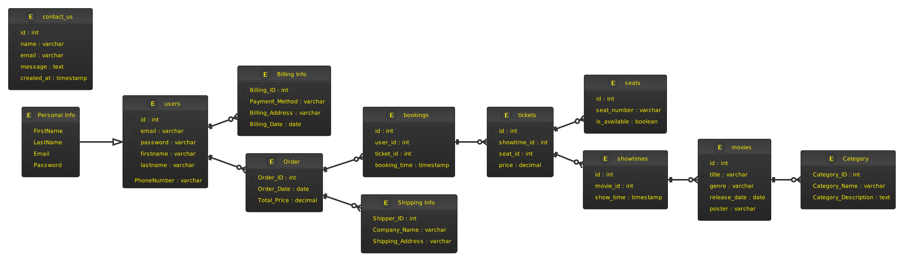

# Nexus Cinema — Movie Ticket Booking

A cinema website where users browse movies by genre, pick a showtime, choose seats on a live seat map
and book tickets. Team project for a web development course.

## Features

- Sign up / sign in with hashed passwords and a profile page
- Movie listings, genre filter and movie details
- Showtimes with an interactive seat map (booked seats loaded with AJAX)
- Ticket booking and confirmation
- About and contact pages with a contact form

## Tech

PHP · MySQL · JavaScript · HTML · CSS

## Run locally (XAMPP)

1. Copy this folder into `xamppfiles/htdocs/`.
2. In phpMyAdmin, create a database named `cinema_site` and import `cinema_web.sql`.
3. Set your MySQL user and password in `php/db.php` and `php/config.php`.
4. Open `http://localhost/cinema-booking/`.
